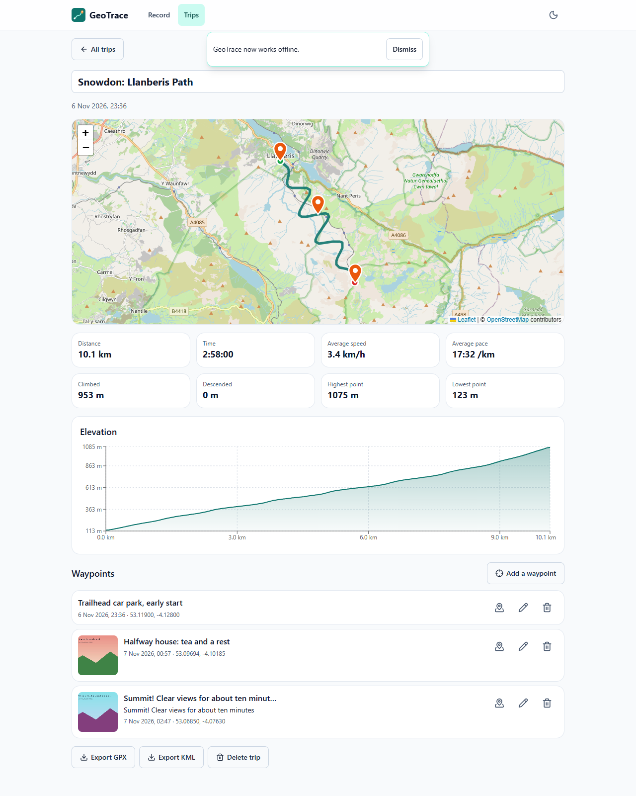
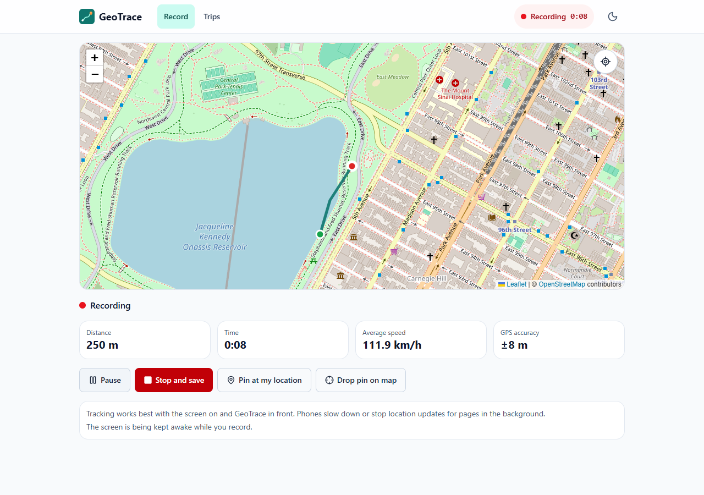
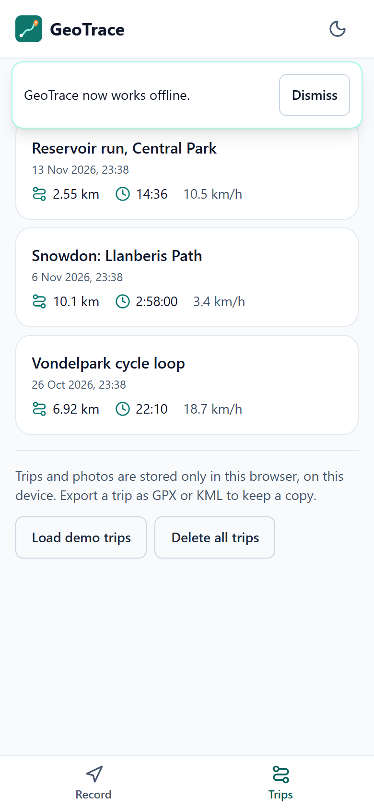
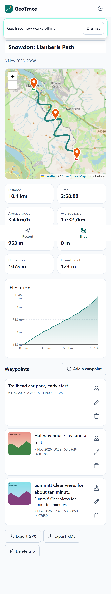
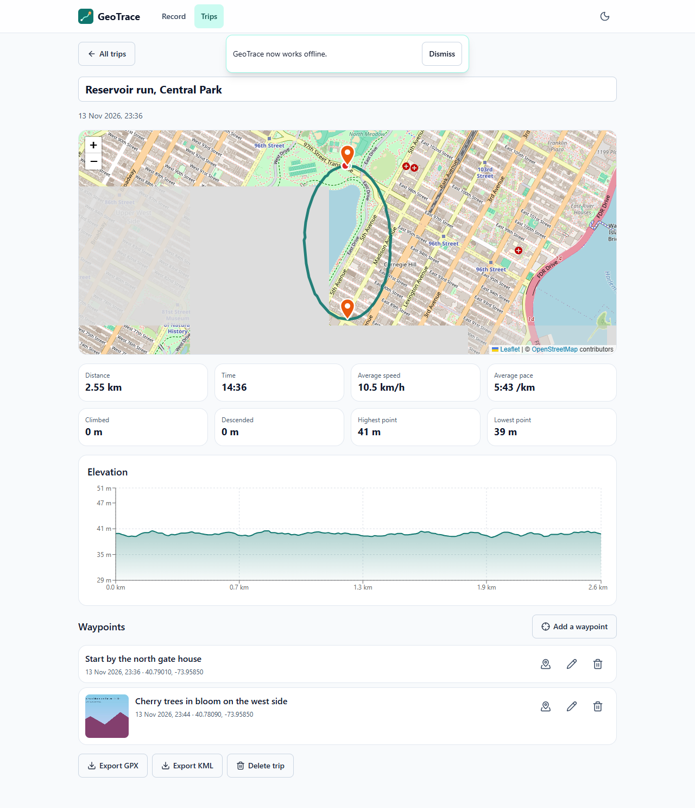

# GeoTrace

Record a trip with live GPS, watch the route draw on a map, drop waypoints with notes and photos, see the elevation profile and export the trip as GPX or KML. Everything is stored on your device, and recording works with no internet connection.

**Live demo:** coming soon (built and tested locally; not deployed yet)
**Run locally:** see [Run locally](#run-locally)



## What to demo to a recruiter

1. **Record a trip:** press *Start trip*. The route draws live, the distance and time update, weak GPS readings are ignored, and the map follows you. Pause and resume, or drop a pin at your location or anywhere on the map with a note and photo.
2. **Open a finished trip:** the whole route fits the map, with stats, an elevation chart, the waypoints and their photos. Rename it, edit or delete waypoints.
3. **Export it:** download GPX or KML and open it in any mapping tool. A pause is kept as a separate segment, so the gap is never joined up as if you had travelled it.

## Features

- **Live recording** with `watchPosition`: start, pause, resume and stop; distance, time, average speed and the accuracy of the latest reading; a live line on the map; and a follow-me mode that turns off when you drag the map.
- **Clean tracks:** readings with a margin of error above 50 m are dropped, readings that barely moved are ignored (compared with the last point kept, so slow walking still adds up), and impossible jumps (over about 250 km/h) are discarded. The screen shows how many weak readings were ignored.
- **Pauses are honest:** resuming starts a new segment, so the time paused is not counted and the gap is not drawn or measured as travel.
- **Waypoints:** drop a pin at your location or tap the map, with a note and an optional photo. Photos are shrunk to 1280 px JPEG before they are stored. Waypoints can be added, edited and deleted on any finished trip too.
- **Trip history and detail:** distance, time, average speed and pace, climbing and descending, highest and lowest point, and an elevation chart (smoothed, with small wobbles ignored when adding up climbing).
- **GPX 1.1 and KML 2.2 export**, hand-built and tested, with XML escaping and removal of characters that XML forbids.
- **Interrupted trips are not lost:** if the page closes mid-recording, the trip is kept and offered back to resume or finish.
- **PWA:** installable, offline-first, with an update banner that waits for you to tap Reload. Light and dark themes. Three demo trips are added on first launch.

**Phase 2 (not built):** offline caching of map tiles for a chosen area, importing GPX, and optional sync.

## Stack

React 19, Vite, TypeScript (strict), Tailwind CSS v4, Leaflet with react-leaflet and OpenStreetMap tiles (no map token), the Geolocation API, Screen Wake Lock API, Dexie (IndexedDB), Recharts, `vite-plugin-pwa`, Vitest. No backend, no accounts, no secrets.

## Be honest about the limits

- **Tracking works best with the screen on.** Browsers slow down or stop location updates for pages in the background. GeoTrace asks the browser to keep the screen awake while recording (Screen Wake Lock) and takes the lock again when you come back to the page, but if the phone locks anyway or another app comes to the front, readings can stop. It is not a replacement for a native fitness app on a long outdoor trip.
- **The map needs internet.** Recording, history, waypoints and exports all work offline, but OpenStreetMap tiles are fetched live, so offline the route is still drawn on a blank map. Caching tiles for offline use is Phase 2, and would need to respect OpenStreetMap's tile usage policy.
- **Altitude depends on the device.** Some phones and browsers report none, in which case the trip says so instead of drawing an empty chart.
- **The demo trips are synthetic.** They are generated along approximate real coordinates (a reservoir loop in Central Park, the Llanberis Path up Snowdon and a loop round Vondelpark) with realistic speed, pauses, GPS noise and altitude. They are not recorded GPS tracks.
- **Not tested outdoors.** I have not tested this on a real phone moving through the real world, only with simulated GPS in a browser (see Verified).

## Architecture notes

- **Pure, tested core.** Haversine distance, the reading filter, the elevation profile and climbing totals, speed and pace, and the GPX and KML writers are plain functions with unit tests, separate from React. The XML output is also checked for well-formedness in tests and parsed with a real `DOMParser` in the browser tests.
- **Recorder as a provider.** Recording lives above the screens, so it carries on while you look at your history; the header shows a live indicator on every screen.
- **Readings are handled one at a time.** Each GPS reading is judged against the last point that was kept, saved to IndexedDB and added to the line in strict order, so two readings arriving together cannot both be judged against stale state.
- **A trip exists from its first good reading.** It is created then, not when you press Start, so asking for permission and being refused leaves nothing behind. Totals are saved as you go, which is what makes an interrupted trip recoverable.
- **The demo can never overwrite your data.** The demo trips are built in the background after the page has loaded. They are added only if there are no trips at all, with that check and the insert in one transaction (tested, including two racing at once), so a trip you start in the first seconds is safe.
- **Maps are client-only and resize-aware.** A `ResizeObserver` keeps the map correct when a phone rotates; the fit-to-route and follow-me behaviour only act on a real change, so the growing line never snaps the view back.
- **No image files for markers or photos.** Pins are inline SVG, and the sample waypoint photos are drawn in the browser.
- The charting library (the largest dependency) loads only when a trip with altitude data is opened.

```
src/lib/        geo maths and filters, elevation, GPX and KML writers, XML helpers, formats, seed, IndexedDB layer (tested)
src/hooks/      useTripRecorder (GPS, pause, wake lock, recovery), routing, object URLs
src/features/   record, trips (list, detail, stats, chart), map (Leaflet), waypoints
src/providers/  recorder, trip data, theme
```

## Run locally

Requires Node 22 or later. Geolocation needs a secure page: `localhost` counts, and so does any https address.

```bash
npm install
npm run dev          # http://localhost:5312
```

To try the installable, offline build: `npm run build && npm run preview` (http://localhost:4182).
Other scripts: `npm run lint`, `npm run typecheck`, `npm test`. In Chrome you can fake a position under DevTools, More tools, Sensors.

## Screenshots

| Recording | Trips (phone) | A trip (phone) |
| --- | --- | --- |
|  |  |  |



## Performance

Lighthouse on the production build, mobile profile with simulated slow 4G: Performance 94, Accessibility 100, Best Practices 96, SEO 100; total blocking time 90 ms. Observed first paint 239 ms and largest paint 589 ms. The first load is about 165 kB gzipped (React, Leaflet and the database); the chart adds about 106 kB, only when needed.

## Verified

Typecheck, lint and build pass, and 84 automated tests pass (distance maths against known distances, the reading filter, elevation and climbing, GPX and KML structure and escaping, formats, the demo trips, GPS error mapping and the IndexedDB layer). An 87-check browser run (Playwright, Chromium) against the production build **fed simulated GPS positions, with altitude, through the browser's geolocation** and covered: a walk with live distance, time and a drawn line; a weak reading, a stationary jitter and an 11 km teleport being ignored; pause, a 1.5 km move while paused and resume (not counted as travel, saved as a new segment); the wake-lock calls (taken, released, taken again, and taken again when the page returns); pins at my location and on the map; stopping into the finished trip; an interrupted trip (page reloaded mid-recording) resumed and another finished as it stood; a denied permission, a browser with no location support and no signal then signal returning; the history, route fitted to the map, stats, the elevation chart, waypoints with photos (a 2400 px photo shrunk to 7 KB), GPX and KML exports parsed by a real `DOMParser`, rename and deletes; 375px layouts with no overflow; the installed build opening history and **recording offline**; real OpenStreetMap tiles drawing under the route; and no console errors.

Not yet checked: a real phone outdoors (real GPS, real background throttling, camera capture), iPhone Safari, and deployment on Netlify.
